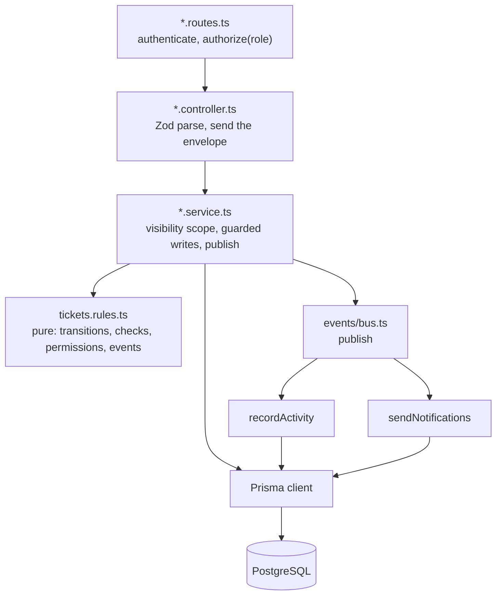
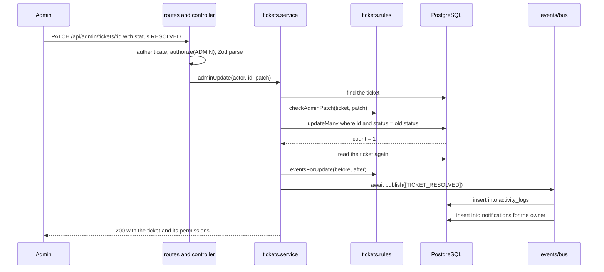

# Mini Helpdesk

[](https://github.com/KlutzyFella/mini-helpdesk/actions/workflows/ci.yml)

Mini Helpdesk is a support ticket system: users raise tickets and comment on them, and admins triage, comment on, and resolve every ticket. It is an Express and TypeScript API on PostgreSQL with a React client, and every ticket change writes an activity log and notifications through an in-process event bus.

## Live demo

- Client: https://mini-helpdesk-xi.vercel.app
- API: https://mini-helpdesk-api.onrender.com

| Role | Email | Password |
|---|---|---|
| Admin | `admin@email.com` | `password` |
| User | `alice@example.com` | `Password123!` |
| User | `bob@example.com` | `Password123!` |

The admin login is public on purpose. Admins cannot delete tickets, so a visitor cannot wipe the demo data. You can also register a new user.

The API runs on Render's free tier in Singapore, and the database is Neon Postgres in AWS Singapore. A free Render service sleeps when idle, so the first request can take up to about a minute. The client shows a "server is waking up" banner during that wait.

## Features

| Assignment section | What is built |
|---|---|
| 3A Authentication | Register and log in with a JWT. Two roles, USER and ADMIN. Role-specific routes check the role with `authorize`, and the client routes each role to its own pages. |
| 3B Tickets | A USER creates tickets with a title, description, category, and priority, lists and reads their own tickets, and follows the status. The owner edits or deletes a ticket while it is `OPEN`. |
| 3C Admin | An ADMIN lists every ticket, filters by status, priority, and category, reads any ticket with its comments, and changes status and priority along a fixed transition table. |
| 3D Comments | The owner and any admin comment on a ticket. Each comment stores its ticket and its author. A `CLOSED` ticket takes no new comments. |
| 4 Events | Five event types: `TICKET_CREATED`, `TICKET_UPDATED`, `STATUS_CHANGED`, `TICKET_RESOLVED`, and `COMMENT_ADDED`. Two subscribers write the activity log and the notifications. Each ticket page shows its activity timeline, and a bell in the header shows each user's unread notifications. |
| 6 Bonus | Search, pagination, sorting, and filtering on the ticket list. An admin stats dashboard with counts by status, priority, and category, and the mean time to resolve. 183 automated tests and a Postman collection. A React frontend. CI on GitHub Actions. |

`docker compose up --build` runs the whole app: Postgres, the API, and the client. Email notifications were not built.

## Tech stack

| Part | Why |
|---|---|
| Node.js 24, Express 5, TypeScript | Express 5 sends a rejected async handler to the error handler, so no wrapper is needed. |
| PostgreSQL 17 | The data is relational: foreign keys, enums, and transactions do real work here. |
| Prisma 7 with `@prisma/adapter-pg` | Typed queries and migrations. The generated enums feed the Zod schemas. |
| Zod 4 | Parses every body, query, and id at the controller, and rejects unknown keys. |
| `jsonwebtoken`, `bcryptjs` | Standard JWT signing and password hashing, with no native build step. |
| `helmet`, `cors`, `express-rate-limit` | Security headers, a CORS allowlist from the environment, and a limit on login and register. |
| `pino`, `pino-http` | JSON logs with a request id on every line and the `authorization` header redacted. |
| Vitest, Supertest | Tests send real HTTP requests to the app against a real Postgres database. |
| React 19, Vite, React Router, TanStack Query, Tailwind CSS 4 | A small single-page client. TanStack Query owns server state and refetching. |
| Render, Neon, Vercel | Free tiers. The API and the database run in the same region. |
| GitHub Actions | Type-checks, tests, and builds the server and the client on every pull request and every push to `main`. |

## Architecture

Each module in `server/src/modules/` has the same files. A request passes down the layers, and only the service talks to Prisma.



An admin status change flows through the event bus like this.



## Run everything with Docker

You need Docker. From the repository root:

1. Create the server's `.env` and set `JWT_SECRET` (at least 32 characters) and `ADMIN_PASSWORD` in it. Compose reads this file. It replaces `DATABASE_URL`, `NODE_ENV`, `PORT`, and `CORS_ORIGINS` with values for the containers.

	```sh
	cp server/.env.example server/.env
	```

2. Build and start Postgres, the API, and the client.

	```sh
	docker compose up --build
	```

3. Open the client at http://localhost:8080. The API is at http://localhost:4000. Sign in with the `ADMIN_EMAIL` and `ADMIN_PASSWORD` from `server/.env`, or as `alice@example.com` with `Password123!`.

The API container migrates and seeds the database on every start, as the Render service does. The seed is safe to repeat. To start over from an empty database, run `docker compose down -v`, which deletes the data volume.

## Local setup

You need Node.js 24 and Docker. The API and client run on your machine, and only Postgres runs in Docker. If the full Docker stack is running, stop it first with `docker compose stop server client`, because the API dev server also uses port 4000.

1. From the repository root, start Postgres. The init script also creates the `helpdesk_test` database.

	```sh
	docker compose up -d db
	```

2. Create the server's `.env`. Create it before `npm install`, because the install runs `prisma generate`, which reads `DATABASE_URL`.

	```sh
	cd server
	cp .env.example .env
	```

3. In `server/.env`, set `JWT_SECRET` to a random string of at least 32 characters, and set `ADMIN_PASSWORD`.

4. In `server/`, install, migrate, and seed.

	```sh
	npm install
	npx prisma migrate deploy
	npm run seed:dev
	```

5. In `server/`, start the API on http://localhost:4000.

	```sh
	npm run dev
	```

6. In a second terminal, from the repository root, start the client on http://localhost:5173.

	```sh
	cd client
	cp .env.example .env
	npm install
	npm run dev
	```

Sign in with the `ADMIN_EMAIL` and `ADMIN_PASSWORD` from `server/.env`, or as `alice@example.com` with `Password123!`.

## Environment variables

The server parses its environment with Zod in `server/src/config/env.ts` and exits at boot if a value is invalid.

| Variable | Default | Purpose |
|---|---|---|
| `DATABASE_URL` | required | Postgres connection string |
| `JWT_SECRET` | required | HS256 signing key, at least 32 characters |
| `JWT_EXPIRES_IN` | `1d` | token lifetime |
| `PORT` | `4000` | HTTP port |
| `NODE_ENV` | `development` | `development`, `test`, or `production` |
| `BCRYPT_ROUNDS` | `12` | bcrypt cost, 4 to 15. Tests use 4. |
| `AUTH_RATE_LIMIT` | `10` | login and register requests per minute per IP |
| `CORS_ORIGINS` | empty | comma-separated origins the browser may call from |
| `LOG_LEVEL` | `info` | pino log level |
| `ADMIN_EMAIL`, `ADMIN_PASSWORD` | none | the admin account the seed creates. The seed refuses to run without them. |
| `DEMO_PASSWORD` | `Password123!` | password for the two demo users |
| `VITE_API_URL` (client) | `http://localhost:4000` | API base URL, read at build time |

## Tests

The server tests need the compose database. Vitest loads `server/.env.test`, migrates `helpdesk_test` once, and truncates every table before each test.

```sh
cd server && npm test
cd client && npm test
```

| Suite | Files | Tests |
|---|---|---|
| Server: API, rules, race, events | 7 | 144 |
| Client: guards, API client, triage, badges, formatting | 6 | 24 |

Server coverage from `cd server && npx vitest run --coverage` is 95.5% of statements, 89.1% of branches, and 96.8% of lines, over the server files the tests load. `src/server.ts`, which only starts the listener, is not loaded.

`docs/helpdesk.postman_collection.json` is the smoke suite: 30 requests with assertions on each one. A newman run of the full collection against the live API passed every request and assertion. See [running the Postman collection](docs/API.md#run-the-postman-collection) for the command.

## Implementation decisions

**A missing ticket, another user's ticket, and a malformed id all return 404.** A 403 for someone else's ticket would confirm that the id exists. One rule covers all three: anything you cannot see is 404. The controller checks the id with `z.uuid()` first, because Prisma throws on a malformed UUID and that would otherwise surface as a 500.

**Checks run in a fixed order, and each check owns one status code.** `authenticate` returns 401. `authorize(role)` on the route returns 403. The controller's Zod parse returns 404 for a bad id and 400 for a bad body. The visibility lookup returns 404. The pure rules return 409, and the guarded write returns 409. The same input always fails the same way, and the tests cover each step.

**Owners and admins use two PATCH routes.** `PATCH /api/tickets/:id` takes `title`, `description`, and `category` from the owning USER. `PATCH /api/admin/tickets/:id` takes `status` and `priority` from an ADMIN. The role gate is visible in `tickets.routes.ts`, and each route has one strict schema. A USER who sends `status` gets a 400 that names the field, and a USER who calls the admin route gets a 403.

**Writes are guarded against races.** A rule check reads the ticket, then writes. Two admins can both pass the check before either one writes. Each write puts the state it checked into the `where` clause of an `updateMany`, and a count of 0 returns 409. `server/test/race.test.ts` holds two status moves at the write until both have passed the check, then releases them. One returns 200 and the other returns `409 CONCURRENT_UPDATE`.

**The server sends `permissions` to the client.** Every ticket response carries `{ edit, priority, delete, comment, nextStatuses }`. The same predicates in `tickets.rules.ts` build this object and guard the writes, and `server/test/ticketRules.test.ts` checks that they agree for every role and status. The client shows a button only when its flag is true, and never copies a rule.

**Status moves follow one table.** `TRANSITIONS` in `tickets.rules.ts` lists the allowed moves: `OPEN` to `IN_PROGRESS` or `CLOSED`, `IN_PROGRESS` to `RESOLVED` or `OPEN`, `RESOLVED` to `CLOSED` or `IN_PROGRESS`, and nothing out of `CLOSED`. The check, `permissions.nextStatuses`, and the tests all read this table, and `ticketRules.test.ts` checks all 16 pairs of statuses.

**Events are awaited after the write commits, and each is delivered at most once.** `publish(events)` in `server/src/events/bus.ts` runs each subscriber in turn and logs any failure without failing the request. The activity row is not written in the same transaction as the change, because a failing subscriber there would roll back the user's change. A crash between the commit and `publish` loses that event's rows. The production fix is a transactional outbox: write the event to a table in the same transaction, and let a worker deliver it.

**There is no repository layer.** Prisma is already the data mapper, so a repository would only forward calls. The service calls Prisma directly, and the pure rules in `tickets.rules.ts` hold the logic that tests need to reach without a database.

**The JWT carries only `sub`.** `authenticate` reads the user's role from the database on every request. A role change or a deleted user takes effect on the next request, and a token cannot claim a role it does not have. The cost is one primary-key lookup per request.

**The client keeps the bearer token in `localStorage`, not in an httpOnly cookie.** The client and the API are on different sites, `vercel.app` and `onrender.com`. A cookie would be third-party, which needs `SameSite=None` and CSRF protection, and some browsers block it. A token in a header is never sent by the browser on its own, so there is no CSRF. The cost is that a script injected into the page could read the token. React escapes all output, the client uses no `dangerouslySetInnerHTML`, and the token expires after one day.

**Only login and register are rate-limited.** Those two routes take a password or create an account, so they are where guessing and spam happen. Every other route needs a valid token. A limit on all of `/api/auth` would also throttle `/api/auth/me`, which the client calls on every page load that has a saved token.

**The ticket list runs at REPEATABLE READ.** The page and its count are two statements. At the default READ COMMITTED isolation, a ticket created between them can make `meta.total` disagree with the rows. One REPEATABLE READ transaction gives both statements one snapshot. See [the database design](docs/DATABASE.md#why-the-list-and-its-count-share-one-repeatable-read-transaction).

## Known limits

- A ticket has no assignee. Every admin sees every ticket.
- A comment insert is not guarded against a close. A comment and a close in the same instant can leave one comment on a `CLOSED` ticket.
- A token cannot be revoked before it expires. The fix is a `tokenVersion` column on `users`, put in the token and checked by `authenticate`. It is not built.
- The free Render service sleeps when idle, so the first request after a pause can take up to about a minute.
- `npm audit` in `server/` reports 3 high-severity advisories in `effect`, a dependency of the Prisma CLI's config loader. That code runs only at build and migrate time, and the only fix is a downgrade to Prisma 6.
- Email notifications were not built.

## More documentation

- [API reference](docs/API.md): endpoints, error codes, the `permissions` object, activity types, and the Postman collection.
- [Database design](docs/DATABASE.md): tables, indexes, delete rules, and the query plan for the ticket list.
