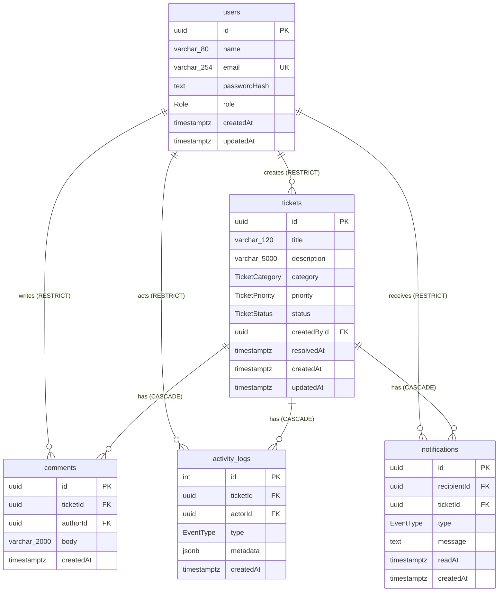

# Database design

The app stores its data in PostgreSQL 17 through Prisma 7. The schema is in `server/prisma/schema.prisma`, and one migration creates all of it: `server/prisma/migrations/20261126095331_init/migration.sql`.

This page has two parts. The reference part lists the tables, keys, indexes, and enums. The design part explains the choices behind them.

## Entity diagram



## Tables

Every column is `NOT NULL` unless the table says otherwise. Every `id` except `activity_logs.id` is a UUID that Prisma generates.

### `users`

| Column | Type | Notes |
|---|---|---|
| `id` | `uuid` | primary key |
| `name` | `varchar(80)` | |
| `email` | `varchar(254)` | unique. Zod trims and lowercases it before every insert and lookup. |
| `passwordHash` | `text` | bcrypt hash. A global Prisma `omit` hides it from every query except login. |
| `role` | `Role` | default `USER` |
| `createdAt`, `updatedAt` | `timestamptz(3)` | Prisma sets `updatedAt` on each write |

| Index | Reason |
|---|---|
| `users_email_key` unique on `email` | Login finds a user by email. The unique constraint also stops two registrations of one address. Register inserts first and maps the violation to `409 EMAIL_TAKEN`, so a race between two sign-ups never returns 500. |

### `tickets`

| Column | Type | Notes |
|---|---|---|
| `id` | `uuid` | primary key |
| `title` | `varchar(120)` | |
| `description` | `varchar(5000)` | |
| `category` | `TicketCategory` | |
| `priority` | `TicketPriority` | default `MEDIUM` |
| `status` | `TicketStatus` | default `OPEN` |
| `createdById` | `uuid` | foreign key to `users.id`, `ON DELETE RESTRICT` |
| `resolvedAt` | `timestamptz(3)`, nullable | set on a move to `RESOLVED`, kept on a move to `CLOSED`, cleared on any other move |
| `createdAt`, `updatedAt` | `timestamptz(3)` | |

| Index | Reason |
|---|---|
| `(createdById, createdAt)` | A USER's list is always filtered to `createdById` and sorted by `createdAt` by default. |
| `(status, priority, createdAt)` | The admin list filters by status and priority (assignment section 3C). The [query plan section](#what-the-query-plan-shows) shows that the planner does not use it at 5,000 rows. |
| `(createdAt)` | The admin list with no filter sorts by `createdAt desc`. A backward scan of this index reads the newest rows first, so the first page needs only a small incremental sort on the `id` tiebreak. |

### `comments`

| Column | Type | Notes |
|---|---|---|
| `id` | `uuid` | primary key |
| `ticketId` | `uuid` | foreign key to `tickets.id`, `ON DELETE CASCADE` |
| `authorId` | `uuid` | foreign key to `users.id`, `ON DELETE RESTRICT` |
| `body` | `varchar(2000)` | |
| `createdAt` | `timestamptz(3)` | |

| Index | Reason |
|---|---|
| `(ticketId, createdAt)` | The thread for one ticket is read oldest first. |

### `activity_logs`

| Column | Type | Notes |
|---|---|---|
| `id` | `serial` (`Int`) | primary key, autoincrement |
| `ticketId` | `uuid` | foreign key to `tickets.id`, `ON DELETE CASCADE` |
| `actorId` | `uuid` | foreign key to `users.id`, `ON DELETE RESTRICT` |
| `type` | `EventType` | |
| `metadata` | `jsonb`, nullable | shape depends on `type`. See the [activity types in the API reference](API.md#activity-types). |
| `createdAt` | `timestamptz(3)` | |

| Index | Reason |
|---|---|
| `(ticketId, id)` | The timeline for one ticket is read in `id` order. |

### `notifications`

| Column | Type | Notes |
|---|---|---|
| `id` | `uuid` | primary key |
| `recipientId` | `uuid` | foreign key to `users.id`, `ON DELETE RESTRICT` |
| `ticketId` | `uuid` | foreign key to `tickets.id`, `ON DELETE CASCADE` |
| `type` | `EventType` | |
| `message` | `text` | written by the server, never by a user |
| `readAt` | `timestamptz(3)`, nullable | null until the recipient marks it read |
| `createdAt` | `timestamptz(3)` | |

| Index | Reason |
|---|---|
| `(recipientId, readAt, createdAt)` | One index serves both notification queries: the newest 20 for a recipient, and the count of rows where `readAt` is null. |

## Enums

Each enum is a PostgreSQL enum type. The ticket Zod schemas read their values from the generated Prisma client, so the API and the database cannot disagree.

| Enum | Values |
|---|---|
| `Role` | `USER`, `ADMIN` |
| `TicketCategory` | `BUG`, `BILLING`, `ACCOUNT`, `FEATURE_REQUEST`, `OTHER` |
| `TicketPriority` | `LOW`, `MEDIUM`, `HIGH`, `URGENT` |
| `TicketStatus` | `OPEN`, `IN_PROGRESS`, `RESOLVED`, `CLOSED` |
| `EventType` | `TICKET_CREATED`, `TICKET_UPDATED`, `STATUS_CHANGED`, `TICKET_RESOLVED`, `COMMENT_ADDED` |

PostgreSQL sorts an enum by the order of its declaration. That makes `?sort=priority` order tickets from `LOW` to `URGENT` with no lookup table.

## Design decisions

### Delete rules

Every foreign key to `users` is `ON DELETE RESTRICT`. No endpoint deletes a user, and a user who wrote comments or moved tickets is part of the history of those tickets. If a user is ever deleted by hand, the database refuses while that user still owns any row.

Every foreign key to `tickets` is `ON DELETE CASCADE`. Only the owner can delete a ticket, and only while it is `OPEN`. When that happens, the ticket's comments, activity rows, and notifications go with it. Once an admin moves a ticket out of `OPEN`, the owner can no longer delete it. Admins close tickets and cannot delete them, so a ticket that an admin worked on keeps its full history.

`ticketId` is `NOT NULL` on `comments`, `activity_logs`, and `notifications`. For that reason the app has no "ticket deleted" event. Its activity row would point at a ticket that no longer exists, and the foreign key would reject the insert.

PostgreSQL does not index a foreign key column on its own. Three foreign key columns are not the first column of any index: `comments.authorId`, `activity_logs.actorId`, and `notifications.ticketId`. A user delete would scan `comments` and `activity_logs`, but no user is ever deleted. A ticket delete scans `notifications` for its `ticketId`. That cost is small at demo scale and is the first index to add if the table grows.

### Why every timestamp is `Timestamptz`

Every `DateTime` column is `@db.Timestamptz(3)`. PostgreSQL stores a `timestamptz` as an absolute instant in UTC. A plain `timestamp` stores a wall-clock time with no zone, so its meaning depends on the zone of whichever process wrote it. The API returns each value as ISO 8601 in UTC, such as `2026-11-26T12:25:08.794Z`, and the client renders it in the viewer's zone. The `(3)` keeps millisecond precision, which matches a JavaScript `Date`.

### Why `activity_logs.id` is an autoincrement `Int`

The activity log is append-only, and the timeline must show rows in the order they were written. A sequence gives that order for free. `createdAt` cannot, because two rows from one request can share a millisecond. One admin request that changes status and priority writes two rows, and the status row must come first. The endpoint orders by `id` alone.

The column is `Int` and not `BigInt`, because `JSON.stringify` throws on a `BigInt`. A 32-bit sequence holds about 2.1 billion rows, far past the life of this app.

### Why the list and its count share one REPEATABLE READ transaction

`GET /api/tickets` runs two statements: `findMany` for the page and `count` for `meta.total`. At PostgreSQL's default isolation, READ COMMITTED, each statement takes its own snapshot. A ticket created between the two statements can appear in the count and not in the page, so `total` and `totalPages` disagree with the rows. Both statements run in one `prisma.$transaction([...], { isolationLevel: "RepeatableRead" })`. At REPEATABLE READ the whole transaction reads one snapshot, so the page and the count always agree. The transaction only reads, so it can never fail with a serialization error.

### Why maximum lengths live in the database and minimum lengths in Zod

A maximum length protects storage, so it is a `varchar(n)` column that holds for every writer: the API, the seed, a script, or `psql`. A minimum length, such as a title of at least 3 characters, is a product rule. It changes more often, and it needs a readable error message, so it lives in the Zod schemas in `server/src/modules/*/*.schemas.ts`. Zod also repeats each maximum, so the user gets a `400 VALIDATION_ERROR` that names the field before the database is reached.

| Field | Zod minimum | Database maximum |
|---|---|---|
| `users.name` | 1 after trim | 80 |
| `users.email` | valid email | 254 |
| `tickets.title` | 3 after trim | 120 |
| `tickets.description` | 10 after trim | 5000 |
| `comments.body` | 1 after trim | 2000 |

A password is at least 8 characters and at most 72 UTF-8 bytes. Only Zod checks it, because the database stores the hash. bcrypt ignores every byte after the 72nd, so a longer password would give a false sense of strength.

### The guarded `updateMany` pattern

A rule check reads a ticket, decides the change is allowed, and then writes. Two requests can both pass the check before either one writes. Each guarded write puts the state it checked into its `where` clause, and uses `updateMany` or `deleteMany`, which return a count instead of throwing. A count of 0 means another request changed the row first.

| Write | `where` clause | Result when the count is 0 |
|---|---|---|
| admin status move | `{ id, status: before.status }` | `409 CONCURRENT_UPDATE` |
| admin priority change only | `{ id, status: { not: "CLOSED" } }` | `409 TICKET_CLOSED` |
| owner edit | `{ id, createdById: actor.id, status: "OPEN" }` | `409 TICKET_LOCKED` |
| owner delete | the owner edit clause, with `deleteMany` | `409 TICKET_LOCKED` |

The code is in `server/src/modules/tickets/tickets.service.ts`. `server/test/race.test.ts` holds both requests at the write until both have passed the check, then releases them. One returns 200 and the other returns `409 CONCURRENT_UPDATE`.

A comment insert has no guard. A comment and a close that land in the same instant can leave one comment on a `CLOSED` ticket. The README lists this as a known limit.

### What the query plan shows

`docs/explain-ticket-list.txt` holds two `EXPLAIN (ANALYZE, BUFFERS)` plans for the admin list filtered to `status=OPEN&priority=HIGH`. The data was 5,000 tickets across 50 users, with random status and priority, and 333 matching rows. The query:

```sql
SELECT * FROM tickets WHERE status = 'OPEN' AND priority = 'HIGH'
ORDER BY "createdAt" DESC, id DESC LIMIT 20;
```

With the `(status, priority, createdAt)` index present, the plan reads as follows. The `Buffers` lines are left out here.

```
Limit  (cost=1.28..21.85 rows=20 width=116) (actual time=0.128..0.131 rows=20 loops=1)
  ->  Incremental Sort  (cost=1.28..316.05 rows=306 width=116) (actual time=0.127..0.129 rows=20 loops=1)
        Sort Key: "createdAt" DESC, id DESC
        Presorted Key: "createdAt"
        ->  Index Scan Backward using "tickets_createdAt_idx" on tickets  (cost=0.28..302.28 rows=306 width=116) (actual time=0.022..0.061 rows=21 loops=1)
              Filter: ((status = 'OPEN'::"TicketStatus") AND (priority = 'HIGH'::"TicketPriority"))
              Rows Removed by Filter: 315
Planning Time: 1.053 ms
Execution Time: 0.199 ms
```

With that index dropped inside a rolled-back transaction, the plan is the same, and it ran in 0.086 ms.

At 5,000 rows the planner prefers a backward scan of the `createdAt` index over the composite index. About 1 row in 15 matches the filter, so walking the newest rows and discarding 315 of them finds 20 matches faster than an index lookup followed by a sort. The composite index does not change the plan at this size. It earns its place when the filter is selective, or when the table is large enough that walking `createdAt` past many non-matching rows costs more than reading the matches directly. The slower first run is most likely planning overhead on a cold cache: its planning step read 171 buffers against 5 in the second run.

## Migrations and seeding

Prisma Migrate owns the schema. To change it, edit `server/prisma/schema.prisma` and run this from `server/`:

```sh
npx prisma migrate dev --name <change>
```

That command writes a new folder under `server/prisma/migrations/` and applies it to the database in `DATABASE_URL`. To apply the committed migrations without creating new ones, run `npx prisma migrate deploy`. The Render start command runs `migrate deploy` on every boot, and the test suite's `globalSetup` runs it against `helpdesk_test` once per run.

The seed is `server/src/scripts/seed.ts`. Run it with `npm run seed:dev` locally, or `npm run seed` after a build. It does these things:

- It upserts the admin from `ADMIN_EMAIL` and `ADMIN_PASSWORD`, and it refuses to run if either is missing.
- It upserts `alice@example.com` and `bob@example.com` as USERs with `DEMO_PASSWORD`, which defaults to `Password123!`.
- It inserts 6 sample tickets in every status, only when the `tickets` table is empty.

The seed upserts by email, so running it twice leaves one admin and two demo users. Render runs it on every boot, which also resets the demo passwords. The sample tickets are inserted with `createMany` and skip the event bus, so they have no activity rows.
